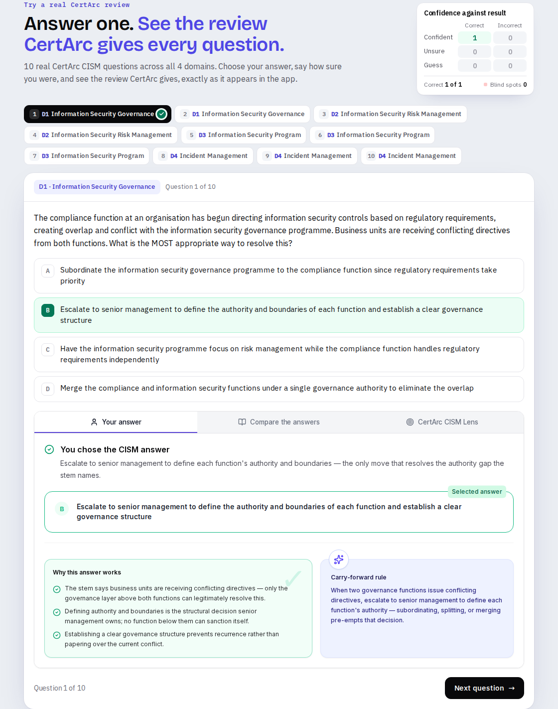

# CertArc for Hermes

Free scenario practice for the CISM, CISSP, CISA, AAISM and AAIA exams, inside Hermes. No account or API key.

[CertArc](https://certarc.com) is independent exam practice built around scenario questions and explanations for every option.



*The free CISM set on certarc.com. Hermes uses the same 10 questions, as text in your chat.*

## Install

```bash
hermes plugins install certarc
hermes plugins enable certarc
```

## Example prompts

- "Give me a CISM practice question."
- "Test me on CISSP."
- "What does the AAISM exam cover?"
- "Find a CertArc guide on CISM incident response."

## How a session goes

1. Ask for a question, and name your exam.
2. Hermes shows the scenario and its options. You choose one and say how sure you are: confident, unsure or guess.
3. Hermes tells you whether you were right and explains each option. If you were confident in a wrong answer, it calls that out as a blind spot.
4. After the 10 questions, or sooner if you want more, Hermes offers the link to CertArc's free assessment.

## What it does

- **Practice:** 10 free scenario questions for each certification. Hermes asks for your answer and how sure you are, then gives CertArc's explanation.
- **Exam outlines:** domains and their weights for each exam.
- **Study guides:** CertArc guides on a topic, with links.
- **Next step:** when you finish a set, or want to keep going, Hermes can give you a link to CertArc's free assessment. You open it and sign in yourself, with Google or a one-time email code. Hermes never signs in or creates an account for you.

The free practice sets are also on the web: [CISM](https://certarc.com/cism/free-practice-questions), [CISSP](https://certarc.com/cissp/free-practice-questions), [CISA](https://certarc.com/cisa/free-practice-questions), [AAISM](https://certarc.com/aaism/free-practice-questions) and [AAIA](https://certarc.com/aaia/free-practice-questions).

## Limits

- Reading your own CertArc study from Hermes isn't available yet. This plugin uses CertArc's free endpoint, which offers only the four tools that need no account.
- The questions are CertArc's own scenarios. They are not official ISACA or ISC2 questions, or recalled exam content. CertArc is not affiliated with ISACA or ISC2, and does not promise any exam outcome.

## Data handling

This plugin is configuration only: a server address and a skill. It runs no local code, reads no local files, stores no credentials and has no telemetry.

- Every tool call goes to `certarc.com`. All four tools are marked read-only.
- CertArc doesn't receive your name or email for practice without an account, and practice answers aren't recorded. Standard web server logs apply, as described in the [privacy policy](https://certarc.com/privacy).
- Your questions and answers also go to whichever model provider you use with Hermes, under that provider's terms.
- The assessment links carry a tag showing they came from this plugin, so CertArc can count sign-ups from it.
- The tool list comes from the hosted server at runtime, so it isn't covered by the pinned commit.

## Support

- [Setup and assistants](https://certarc.com/integrations)
- [Privacy](https://certarc.com/privacy)
- [Terms](https://certarc.com/terms)
- [Support](https://certarc.com/support)

## License

The files in this repository are under the [MIT License](../LICENSE). That doesn't cover CertArc's hosted server, questions, explanations or name.
